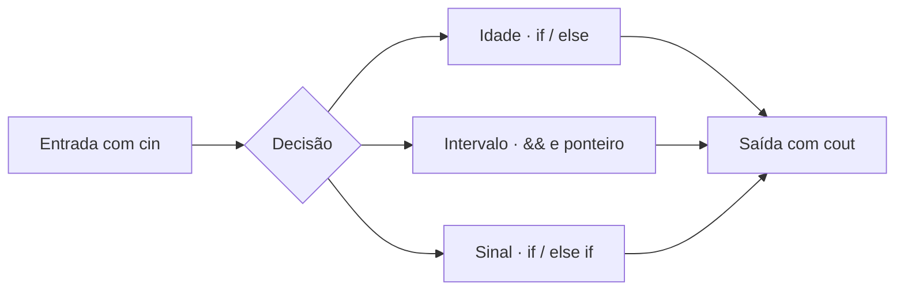

# Atividade — Condicionais e funções em C++

[Voltar ao README principal](../README.md)

Esta pasta reúne três exercícios independentes. Cada arquivo `.cpp` contém sua própria função `main` e tem um executável `.exe` correspondente no repositório.

## Conteúdo dos exercícios

| Arquivo | O que o programa faz | Conceitos presentes |
|---|---|---|
| [exercicio_01.cpp](exercicio_01.cpp) | Lê uma idade inteira e compara o valor com 18. | Entrada com `cin`, saída com `cout` e `if/else`. |
| [exercicio_02.cpp](exercicio_02.cpp) | Verifica se um inteiro está no intervalo inclusivo de 10 a 20. | Função `resultado(int *n)`, ponteiro e operador lógico `&&`. |
| [exercicio_03.cpp](exercicio_03.cpp) | Classifica um número como positivo, negativo ou zero. | Tipo `float`, função com passagem por valor e `if/else if/else`. |

## Compilar

Execute os comandos abaixo a partir da raiz do repositório, em um terminal Bash com `g++` disponível:

```bash
mkdir -p /tmp/aula-github-teste
g++ Atividade/exercicio_01.cpp -o /tmp/aula-github-teste/idade
g++ Atividade/exercicio_02.cpp -o /tmp/aula-github-teste/intervalo
g++ Atividade/exercicio_03.cpp -o /tmp/aula-github-teste/sinal
```

## Executar e conferir

Escolha um dos executáveis:

```bash
/tmp/aula-github-teste/idade
/tmp/aula-github-teste/intervalo
/tmp/aula-github-teste/sinal
```

Cada programa solicita um número e termina após apresentar o resultado.

| Exercício | Entradas de exemplo | Classificações correspondentes |
|---|---|---|
| Idade | `17` e `18` | Menor de idade e maior de idade. |
| Intervalo | `9`, `10`, `20` e `21` | Fora, dentro, dentro e fora do intervalo. |
| Sinal | `5`, `-5` e `0` | Positivo, negativo e zero. |

Os comandos de compilação usam os arquivos-fonte e preservam os arquivos `.exe` já existentes na pasta.

---

## Casos de teste recomendados

Testes simples de fronteira ajudam a conferir os critérios implementados sem alterar os programas:

| Arquivo | Entrada | Resultado esperado pela condição |
|---|---:|---|
| [Exercício 01](exercicio_01.cpp) | `17` | Menor de idade |
| [Exercício 01](exercicio_01.cpp) | `18` | Maior de idade |
| [Exercício 02](exercicio_02.cpp) | `9` | Fora do intervalo |
| [Exercício 02](exercicio_02.cpp) | `10` | Dentro do intervalo |
| [Exercício 02](exercicio_02.cpp) | `20` | Dentro do intervalo |
| [Exercício 02](exercicio_02.cpp) | `21` | Fora do intervalo |
| [Exercício 03](exercicio_03.cpp) | `-0.5` | Negativo |
| [Exercício 03](exercicio_03.cpp) | `0` | Zero |
| [Exercício 03](exercicio_03.cpp) | `0.5` | Positivo |

## Relação entre conceitos e arquivos



### No Windows com Git Bash

Instale um compilador compatível, como `g++` via [MSYS2](https://www.msys2.org/), e execute os comandos na raiz do repositório:

```bash
g++ Atividade/exercicio_01.cpp -o idade.exe
./idade.exe
```

Os exercícios **não possuem testes automatizados** e não validam explicitamente entradas não numéricas. Para contexto e índice, consulte [o README principal](../README.md).
