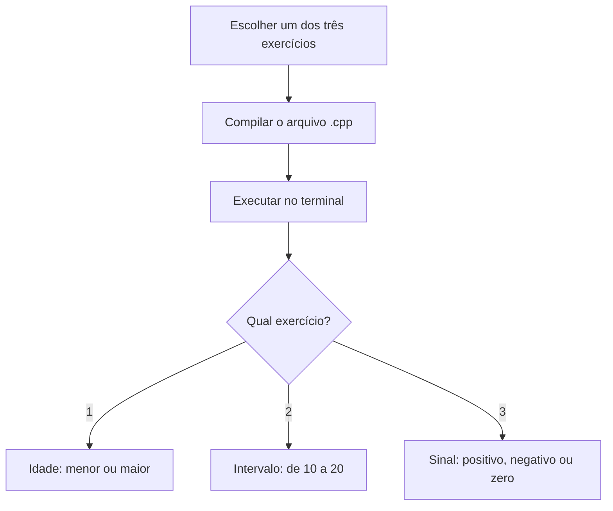

# Aula GitHub Teste

 


## 🕹️ Trilha de desafios · Fundamentos de programação

> **Sua missão:** dominar decisões em C++ por meio de três pequenos programas. Os pontos abaixo são **XP didáticos** para acompanhar seu estudo; não são registrados automaticamente pelo GitHub.

| Nível | Missão prática | Evidência no código | XP |
|:--:|---|---|--:|
| 01 · Explorador | Compilar o teste de maioridade e verificar entradas 17 e 18 | [`exercicio_01.cpp`](Atividade/exercicio_01.cpp) | 20 |
| 02 · Analista | Testar os limites 9, 10, 20 e 21 | [`exercicio_02.cpp`](Atividade/exercicio_02.cpp) | 30 |
| 03 · Decisor | Conferir positivo, negativo e zero | [`exercicio_03.cpp`](Atividade/exercicio_03.cpp) | 30 |
| Bônus · Mentor | Explicar por que `resultado(&n)` passa um endereço | [`exercicio_02.cpp`](Atividade/exercicio_02.cpp) | 20 |

**Progresso manual**

- [ ] Compilar os três arquivos individualmente.
- [ ] Testar os limites de cada condicional.
- [ ] Explicar a diferença entre passagem por ponteiro e por valor.
- [ ] Consultar os [casos de teste documentados](Atividade/README.md).

<details>
<summary><strong>🏅 Conquistas e critérios de conclusão</strong></summary>

| Conquista | Critério |
|---|---|
| 🥉 Primeira compilação | Executar o exercício de idade com sucesso |
| 🥈 Mestre das condições | Justificar os resultados nos limites 10 e 20 |
| 🥇 Trio concluído | Compilar e testar os três exercícios |
| 💎 Código compreendido | Explicar ponteiros e passagem de parâmetros |

Esses títulos são marcos de estudo, **não certificados ou verificações automáticas**.

</details>

**🧩 Desafio extra:** modifique uma cópia local do exercício de idade para rejeitar números negativos; a validação ainda não existe no fonte original.

---

Repositório com exercícios de C++ para praticar entrada de dados, estruturas condicionais e funções. Os três programas estão na pasta [Atividade](Atividade/README.md).

## Organização

| Caminho | Conteúdo |
|---|---|
| [Atividade](Atividade/README.md) | Três exercícios com código-fonte e executáveis `.exe`. |
| [teste_codigo.cpp](teste_codigo.cpp) | Arquivo de teste que contém apenas o comentário `//teste`. |
| [teste.txt](teste.txt) | Arquivo vazio. |

## Exercícios

| Código-fonte | Entrada | Regra aplicada |
|---|---|---|
| [exercicio_01.cpp](Atividade/exercicio_01.cpp) | Uma idade inteira | Idades menores que 18 são classificadas como “Menor de idade.”; as demais, como “Maior de idade.” |
| [exercicio_02.cpp](Atividade/exercicio_02.cpp) | Um número inteiro | Verifica se o número pertence ao intervalo de 10 a 20, incluindo os dois limites. A função recebe um ponteiro para o número. |
| [exercicio_03.cpp](Atividade/exercicio_03.cpp) | Um número do tipo `float` | Informa se o número é positivo, negativo ou zero. A função recebe o número por valor. |

## Compilação e execução

Cada exercício tem sua própria função `main` e deve ser compilado separadamente. Com `g++` disponível, execute os comandos abaixo na raiz do repositório, em um terminal Bash:

```bash
mkdir -p /tmp/aula-github-teste
g++ Atividade/exercicio_01.cpp -o /tmp/aula-github-teste/idade
/tmp/aula-github-teste/idade
```

Digite uma idade quando o programa solicitar. Por exemplo, `17` resulta em “Menor de idade” e `18` resulta em “Maior de idade”.

Os comandos geram o executável fora da pasta do repositório. Consulte o [guia da pasta Atividade](Atividade/README.md) para compilar os três programas.

## Observações sobre o código-fonte

Os programas incluem `iostream` e `locale.h` e chamam `setlocale(LC_ALL, "portuguese")`. A exibição dos acentos depende da codificação dos arquivos e da configuração do terminal.

O arquivo `teste_codigo.cpp` não tem uma função `main`; portanto, não é um quarto exercício executável.

---

## Trilha visual de execução



## Compilação rápida no Windows (Git Bash / PowerShell)

Os comandos abaixo partem da **raiz do repositório**. É necessário ter `g++` no `PATH` (por exemplo, por meio do MSYS2/MinGW-w64):

```bash
g++ Atividade/exercicio_01.cpp -o idade.exe
g++ Atividade/exercicio_02.cpp -o intervalo.exe
g++ Atividade/exercicio_03.cpp -o sinal.exe
```

Execute o programa desejado com `./idade.exe`, `./intervalo.exe` ou `./sinal.exe`. Os três arquivos possuem `main` próprio: **não** compile todos juntos em um único executável.

## Matriz de aprendizado

| Conceito | Exercício | Onde verificar |
|---|---|---|
| Condicionais `if/else` | Maioridade | [exercicio_01.cpp](Atividade/exercicio_01.cpp) |
| Função `void` e ponteiro `int*` | Intervalo | [exercicio_02.cpp](Atividade/exercicio_02.cpp) |
| `float` e `else if` | Sinal numérico | [exercicio_03.cpp](Atividade/exercicio_03.cpp) |
| Guia de testes manuais | Todos | [Atividade/README.md](Atividade/README.md) |

## Perguntas frequentes

**Preciso executar os arquivos `.exe` que já estão no GitHub?** Não. Você pode recompilar os `.cpp` com seu compilador. **Onde ficam os resultados?** São impressos no terminal; os exercícios não salvam arquivos. **Funciona no VS Code?** Sim, usando a extensão C/C++ ou o terminal integrado com `g++` instalado.

> **Rastreabilidade:** as regras acima correspondem aos arquivos-fonte citados; não representam funcionalidades adicionais.
